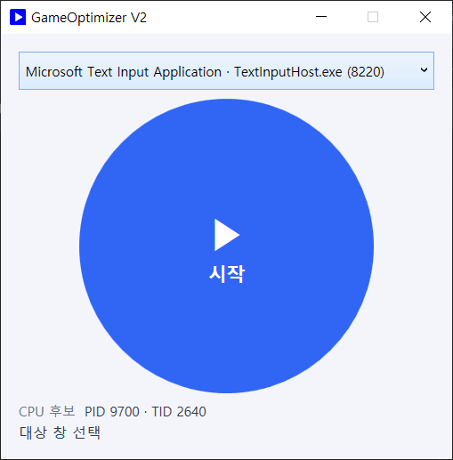
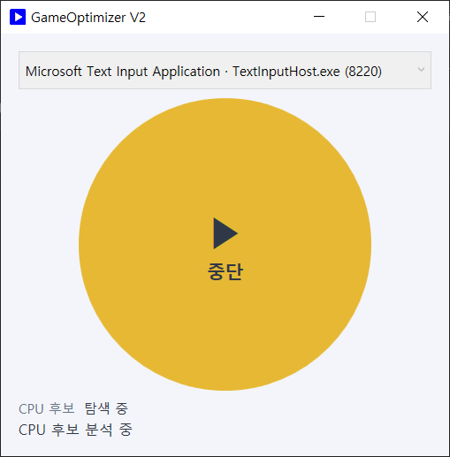
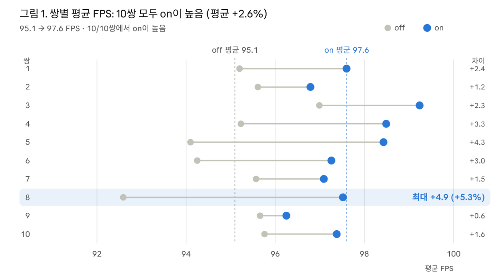

# GameOptimizer v3

스레드 하나가 일을 거의 다 하는 구형 게임을 위해, **그 스레드를 가장 빠르고 조용한 CPU 코어에 올리고 다른 프로그램은 그 코어에서 비켜 주게 하는** Windows 프로그램입니다.

게임을 고르고 `시작`을 누르면 끝입니다. `중단`을 누르거나 창을 닫으면 원래 설정으로 되돌립니다.

| 대기 | 실행 중 |
|---|---|
|  |  |

## 다운로드

[Releases](https://github.com/tiny38risen/GameOptimizer.V2/releases)에서 zip 파일을 받아 압축을 풀고 `GameOptimizer.exe`를 실행하세요. 설치할 것은 없습니다.

## 실측 결과

마비노기 클라이언트(D3D9, 2코어 4스레드 PC)의 서로 다른 던전 두 곳에서 적용 전후를 60초씩 번갈아 측정했습니다(PresentMon). 원자료와 분석 스크립트는 [`measurements/`](measurements)에 있어 누구나 다시 계산할 수 있습니다.

### 측정 1: 던전 A, 10쌍, 약 115,500프레임



| 지표 | 적용 전 | 적용 후 | 변화 | 보정 후 유의 |
|---|---|---|---|---|
| 평균 FPS | 95.1 | 97.6 | **+2.6%** | ✔ (10쌍 모두 개선) |
| 프레임 간 변동 (ms) | 0.87 | 0.77 | **−11.7%** | ✔ (10쌍 모두 개선) |
| CPU Busy (ms) | 10.14 | 9.85 | **−2.8%** | ✔ (10쌍 모두 개선) |
| p99 프레임타임 (ms) | 14.10 | 13.85 | −1.8% | – |
| 1% low FPS | 58.8 | 57.2 | −2.8% | – |
| GPU Busy (ms) | 4.51 | 4.56 | +1.1% | – |

- 쌍별 차이는 Wilcoxon 부호순위 검정, 95% 신뢰구간은 부트스트랩 20,000회로 구했고, Bonferroni 보정을 적용했습니다.
- 평균 FPS의 쌍별 차이는 +2.51 FPS(95% CI +1.73 ~ +3.34)입니다.
- **측정 순서 점검:** 같은 데이터를 on→off 순서 쌍으로 다시 묶어도 +2.55 FPS(9쌍 중 8쌍 on 우세)로 결과가 같습니다. 시간이 지나며 생긴 변화가 아니라 적용 여부가 차이를 만든 것으로 봅니다.
- 1% low FPS와 p99 프레임타임은 보정 후 유의한 차이가 없었습니다.
- 자세한 내용은 [성능 측정 보고서(PDF)](docs/performance-report-2026-11-18.pdf)에 있습니다.

### 측정 2: 던전 B, 7쌍, 장면 부하 변동이 큰 구간

| 지표 | 적용 전 | 적용 후 | 변화 | 보정 후 유의 |
|---|---|---|---|---|
| 평균 FPS | 51.4 | 53.1 | +3.2% | – (7쌍 중 6쌍 개선) |
| p99 프레임타임 (ms) | 31.2 | 27.7 | −11.1% | – |
| 1% low FPS | 25.2 | 29.9 | +18.7% | – |
| 프레임 간 변동 (ms) | 1.83 | 1.53 | −16.5% | – |

- 회차마다 화면 부하가 크게 달라(평균 47~67 FPS) 유의한 차이를 확인하지 못했습니다. 방향은 측정 1과 같지만 근거로는 약합니다.
- 회차별 수치는 [측정 2 결과](measurements/20261118-2/RESULTS.md)에 있습니다.

### 한계

- PC 한 대, 게임 하나에서 잰 결과입니다. 다른 환경에서도 같은 효과를 보장하지 않습니다.

## 어떻게 동작하나

1. **측정 (약 9.5초, 게임은 건드리지 않음)**: 코어마다 속도를 짧게 재고, 같은 시간 동안 인터럽트·DPC 부하를 PDH 카운터로 수집합니다.
2. **코어 선정**: 가장 빠르고 조용한 물리 코어를 **지배 코어**로, 그와 L3 캐시를 공유하는 다른 코어를 **보조 코어**로 고릅니다.
3. **적용**: 게임은 두 코어에만, 다른 프로그램은 그 바깥에서 실행되게 CPU 범위(affinity)를 바꿉니다.
4. **관찰**: CPU 시간을 80% 이상 쓰는 스레드가 4초 넘게 유지되면 그 스레드를 지배 코어에, 나머지 게임 스레드를 보조 코어에 배치합니다.

## 원상 복구 설계

시스템 전체 설정을 바꾸는 프로그램이라, 비정상 종료에도 원래대로 돌아오는 것을 우선했습니다.

- **복구 저널**: 모든 변경은 적용하기 **전에** 원래 값을 파일에 기록하고 디스크까지 플러시합니다.
- **감시 프로세스**: 앱이 강제 종료되면 별도 감시 프로세스가 저널을 읽어 되돌립니다. 감시 프로세스까지 죽으면 다음 실행 때 복구합니다.
- **신원 확인**: 프로세스는 PID와 생성 시각, 스레드는 TID와 생성 시각으로 확인해 번호가 재사용된 다른 프로그램을 건드리지 않습니다.
- **덮어쓰기 방지**: 현재 값이 우리가 적용한 값일 때만 되돌립니다. 그사이 다른 프로그램이 바꿨다면 손대지 않습니다.

## 지원 환경과 한계

- Windows 10 이상, 64비트. .NET 런타임을 따로 설치할 필요 없습니다.
- 관리자 권한이 필요합니다. 보호 프로세스와 Windows 중요 프로세스는 바꾸지 않습니다.
- CPU 그룹 1개(논리 프로세서 64개 이하)만 지원합니다.
- Ryzen 8코어 16스레드, 2코어 4스레드 PC에서 검증했습니다. 인텔 하이브리드(P/E 코어) CPU는 아직 실측하지 않았습니다.
- 측정 중 속도 프로브가 코어를 잠깐씩 쓰기 때문에 게임이 짧게 끊길 수 있습니다.

## 기술 스택

| 계층 | 기술 |
|---|---|
| 엔진 | C++23 DLL — `std::expected` 오류 모델, RAII 핸들, Win32 · PDH · CPU 토폴로지 API |
| 앱 | C# WPF, .NET 10 (자체 포함 배포) |
| 런처 | C++ — 관리자 권한으로 앱 실행 |
| 연결 | C ABI + P/Invoke |
| 테스트 | 코어 선정 규칙 단위 테스트 + 실제 진단 로그 29개 재현 테스트 |
| CI | GitHub Actions (push·PR마다 엔진 빌드·테스트) |

## 빌드와 테스트

Visual Studio(C++ 데스크톱 개발, .NET 데스크톱 개발)와 .NET 10 SDK가 필요합니다.

```powershell
# 빌드
msbuild .\GameOptimizer.V2.sln -m -p:Configuration=Release

# 엔진 테스트
msbuild .\native\tests\GameOptimizer.Engine.Tests.vcxproj -p:Configuration=Release -p:Platform=x64 "-p:SolutionDir=$PWD/"
.\bin\tests\Release\GameOptimizer.Engine.Tests.exe .\native\tests\fixtures
```

배포 패키지 만드는 법, 코어 선정 규칙, 복구 저널 형식, 튜닝값은 [코드 가이드](CODE_GUIDE_KO.md)에 정리했습니다.
